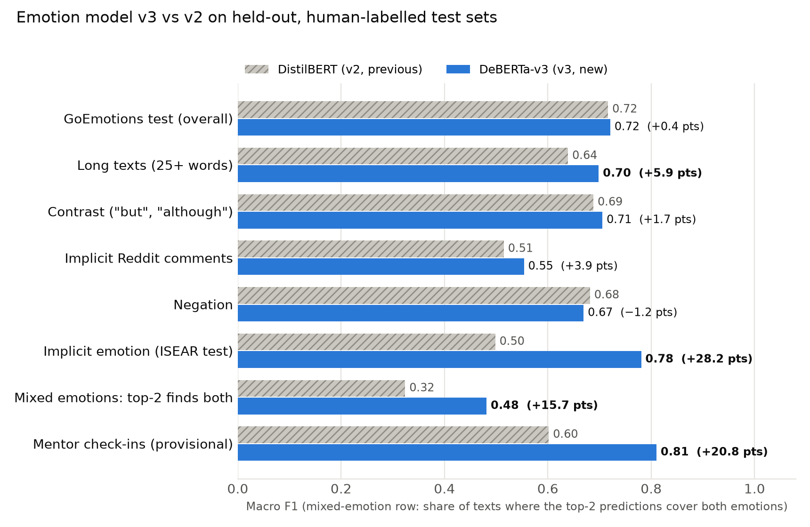

# How the Mentor AI emotion model was trained

This document explains, step by step, how the emotion classifier used by Mentor AI was built, why each
decision was taken, and how its accuracy was measured. Every number quoted here is read from the files in
`reports/metrics/` and can be reproduced with the commands at the end.

The model reads a message written by a user (a chat message, a check-in or a journal entry) and predicts one
of seven emotions, together with a confidence value. It classifies text only; it is **not** a medical or
psychological diagnosis, and the mentoring language model always makes the final decision about how to respond.

| Class | Meaning in Mentor AI |
|---|---|
| `joy` | happiness, excitement, gratitude, relief, love |
| `sadness` | sadness, grief, loss |
| `fear_anxiety` | fear, nervousness, worry |
| `anger_frustration` | anger, annoyance, disgust, disappointment |
| `guilt` | remorse, embarrassment, shame |
| `motivation` | optimism, desire, pride, determination |
| `neutral` | no clear emotion |

---

## 1. Three versions, each fixing the weakness of the previous one

| Version | Model | Main idea | Weakness found |
|---|---|---|---|
| v1 | TF-IDF + linear SVM | counts which words and character patterns appear | cannot read word order: "not happy" looks like "happy" |
| v2 | DistilBERT (66M parameters) | a small pre-trained transformer that reads the whole sentence | struggles with implicit and mixed emotions, calls many real check-ins "neutral" |
| **v3** | **DeBERTa-v3-base (184M parameters) + richer training data** | stronger reader of context, trained on harder, more varied examples | sarcasm (Section 8) |

The same validation and test examples were used for every version, so their scores can be compared directly.

---

## 2. Data

### 2.1 GoEmotions (main dataset)
GoEmotions (Demszky et al., 2020, Google Research) contains 58,009 English Reddit comments. Each comment was
labelled by three to five human annotators with any of 27 emotions or "neutral". Its official train /
validation / test split was kept.

The 27 emotions were mapped onto Mentor AI's seven classes (for example *remorse* and *embarrassment* become
`guilt`). Emotions that do not matter for mentoring (*curiosity*, *confusion*, *surprise*, *admiration*,
*approval*, *caring*, *disapproval*, *realization*) are not used as classes. The full mapping and the reasons
for it are in `data/label_mapping.md`. In an earlier version, `anger` and `frustration` were separate classes,
but frustration reached only 0.27 F1, so the two were merged into `anger_frustration`.

Cleaning was deliberately light: whitespace was normalised, empty and duplicate texts were removed, and any
text that appears in more than one split was removed from the earlier split, so the model can never be tested
on a sentence it has seen. Negations, punctuation, capital letters and emojis were kept, because they carry
emotion ("NOT again 😞").

After cleaning, the frozen splits are **26,947 training, 3,359 validation and 3,400 test** comments. Their
SHA-256 fingerprints are stored in `data/processed/manifest.json`, and every script refuses to run if a file
has changed.

### 2.2 What v3 added (`src/prepare_extra.py`)
v2 threw away every comment that did not fit exactly one class. For v3, three kinds of harder examples were
brought back or added, **to the training data only**:

| Added data | Rows | What it teaches the model |
|---|---:|---|
| GoEmotions comments with one extra, unused emotion (e.g. joy + admiration) | 3,415 | real, messy text where more than one feeling is present |
| GoEmotions **mixed-emotion** comments (annotators chose emotions from two classes, e.g. joy + nervousness) | 1,017 | that one message can carry two feelings; trained as a *soft label* (50 % / 50 %) instead of being discarded |
| **ISEAR** (Scherer & Wallbott, 1994): people from 37 countries describing a real situation in which they felt an emotion | 5,121 | **implicit emotion** – the situation is described, the feeling is usually not named ("When my grandmother died.", "I slammed my brother into a wall.") |
| **Total v3 training set** | **36,460** | 35 % more than v2; the smallest classes grew the most (guilt ×3.9, fear ×2.6, sadness ×2.1) |

ISEAR's seven emotions were mapped as joy→joy, sadness→sadness, fear→fear_anxiety, anger and disgust→
anger_frustration, shame and guilt→guilt. Non-answers such as "NO RESPONSE" (135 rows), texts given two
different labels (11) and duplicates (55) were removed. ISEAR was split 70 / 15 / 15 per emotion: 70 % for
training, 15 % for checking progress during training and 15 % kept as a held-out test.

To prevent leakage, every added text was removed if it also occurs in the validation or test split, the ISEAR
held-out splits or the Mentor-style evaluation set (29 rows removed), and exact duplicates across sources were
dropped (25 rows).

---

## 3. The model: DeBERTa-v3-base

DeBERTa-v3 ("Decoding-enhanced BERT with disentangled attention", He et al., 2021) is a transformer language
model that was pre-trained by Microsoft on 160 GB of English text. Pre-training taught it how words relate to
each other in context; fine-tuning (Section 4) teaches it our seven emotions.

Why it suits complex emotional text:

* **Disentangled attention** – every word is represented twice, once for *what* it is and once for *where* it is.
  The model can therefore tell that "not" changes "happy" in "I'm not happy", and that the part after "but"
  in "I got the job but I'm terrified" usually carries the stronger feeling.
* **Whole-message reading** – unlike the v1 word counter, every word is interpreted in the context of all the
  others, which is what implicit emotion ("third time I skipped the gym this week") requires.
* **Case- and emoji-aware tokeniser** – its SentencePiece tokeniser keeps capitals ("AGAIN") and emojis ("😞")
  as meaningful pieces. It was checked to produce identical tokens to the reference tokeniser on 2,000 texts.

On top of the pre-trained encoder sits a small classification layer with seven outputs, one per emotion.

---

## 4. How the training was done (`src/train_v3.py`)

Training means showing the model the 36,460 labelled texts many times and nudging its weights after each small
batch so that its predictions move closer to the human labels.

| Setting | Value | Reason |
|---|---|---|
| Loss function | cross-entropy against a *soft target* | a normal label is 100 % one class; a mixed-emotion text is 50 % / 50 %, so both feelings are learned |
| Class weights | square root of inverse class frequency | neutral and joy are common, guilt and fear are rare; weighting stops the model ignoring rare emotions without over-punishing neutral |
| Optimiser | AdamW, learning rate 3 × 10⁻⁵, weight decay 0.01 | the standard, stable choice for fine-tuning transformers |
| Layer-wise learning-rate decay | 0.9 per layer | the lower layers already hold general language knowledge, so they are changed less than the top layers |
| Schedule | 10 % warm-up, then cosine decay | starts gently, learns fast in the middle, settles at the end |
| Epochs | 4 (≈ 4,560 weight updates) | enough to converge; the best checkpoint is chosen automatically |
| Batch | 8 texts × 4 accumulation steps = 32 | fits the 6 GB laptop GPU (RTX 3050) while behaving like a batch of 32 |
| Precision | bf16 mixed precision, fp32 master weights | about twice as fast and half the memory, without the instability of pure 16-bit training |
| Frozen word-embedding table | 98M of the 184M parameters | the vocabulary table is general knowledge; freezing it saves 1.2 GB of GPU memory, leaving 86M parameters to train |
| Maximum length | 256 tokens | covers 99.99 % of the training texts (2 of 36,460 were shortened) |
| Length-grouped batches | texts of similar length are batched together | far less padding, so each epoch is much faster |
| Checkpoint selection | the model is scored on the GoEmotions validation split twice per epoch and the best checkpoint is kept | prevents over-training; the test sets are never used for this decision |
| Confidence calibration | temperature scaling fitted on validation | makes "confidence 0.8" mean "right about 80 % of the time", which the backend uses to decide whether to pass the emotion to the mentor |

Two technical problems were found and fixed during development: the published DeBERTa checkpoint is stored
in 16-bit precision, and training those weights directly produced invalid (NaN) values, so the model is now
loaded in 32-bit and only the arithmetic runs in bf16. A batch of long ISEAR stories also exceeded the 6 GB GPU
memory, which was solved with smaller micro-batches, gradient accumulation and the frozen embedding table.

---

## 5. How "complex" emotions are handled

| Difficulty | Example | What addresses it |
|---|---|---|
| Negation | "I'm not okay, honestly." | DeBERTa's position-aware attention; negations kept during cleaning |
| Mixed feelings | "Got the offer but I'm scared I'll fail." | mixed-emotion soft labels; contrast words kept |
| Implicit emotion | "Skipped the gym again. Third time this week." | ISEAR situation descriptions; whole-sentence context |
| Sarcasm and irony | "Oh great, another Monday." | pre-trained knowledge of how phrases are really used; Reddit training text is full of sarcasm |
| Emojis, capitals, slang | "we did it!!! 🎉", "AGAIN" | tokeniser keeps emojis and case; character-level text is preserved |
| Long, multi-sentence entries | journal-style check-ins | 256-token window; attention over the whole entry |
| Rare emotions (guilt, fear) | "I feel awful for snapping at my mum." | extra ISEAR guilt and shame examples; class weights |

---

## 6. How accuracy was measured

The **test data was never used to train or choose a model.** Choices were made on the validation data only,
and each final model was tested once. All benchmarks are labelled by humans.

| Benchmark | Size | What it measures |
|---|---:|---|
| GoEmotions test | 3,400 | overall accuracy on everyday online writing (the same test set as v1 and v2) |
| Complexity slices of that test set | see results | accuracy on negation, contrast, implicit, long, sarcasm-cue and emoji texts (rules in `src/complexity.py`, written before any v3 result was seen) |
| ISEAR held-out test | 1,096 | implicit emotion in first-person situation descriptions |
| Mixed-emotion test | 108 | comments whose annotators chose two emotions: is the top prediction one of them, and do the top two predictions cover both? |
| Mentor-style check-ins | 154 | sentences written in the style of Mentor AI users (labels are still a draft awaiting human review, so these numbers are provisional) |

**Macro F1** is the main score: the F1 score (the balance of precision and recall) is computed for every class
and then averaged, so a rare class such as guilt counts as much as neutral. Accuracy alone would look good
even if the model never predicted the rare emotions.

---

## 7. Results

The final v3 model is DeBERTa-v3-base trained on the v3 data (experiment **E6**, model version
`v2-deberta-v3-base-e6-20260928`). Its best checkpoint was reached after 1.5 of 4 epochs. It was compared with
the previous DistilBERT model on every held-out benchmark, and each benchmark was used **once** for the final
model.



| Benchmark (held-out, human-labelled) | DistilBERT v2 | **DeBERTa v3** | Change |
|---|---:|---:|---:|
| GoEmotions test – macro F1 | 0.717 | **0.721** | +0.4 pts |
| GoEmotions test – accuracy | 78.7 % | **79.5 %** | +0.8 pts |
| Implicit emotion, ISEAR test (1,096) – macro F1 | 0.499 | **0.781** | **+28.2 pts** |
| Mentor-style check-ins (154, provisional labels) – macro F1 | 0.602 | **0.810** | **+20.8 pts** |
| Mixed emotions (108) – top-2 predictions contain both emotions | 32.4 % | **48.1 %** | **+15.7 pts** |
| Mixed emotions – top prediction is one of the emotions | 79.6 % | 79.6 % | 0 |
| Slice: long texts, 25+ words (164) – macro F1 | 0.639 | **0.699** | +5.9 pts |
| Slice: implicit Reddit comments (1,904) – macro F1 | 0.515 | **0.554** | +3.9 pts |
| Slice: contrast words such as "but" (359) – macro F1 | 0.688 | **0.706** | +1.7 pts |
| Slice: negation (747) – macro F1 | **0.682** | 0.669 | −1.2 pts |
| Slice: emoji (142) – macro F1 | **0.776** | 0.754 | −2.2 pts |
| Calibration error on Mentor-style check-ins | 0.220 | **0.056** | 4× better |
| Speed per message (GPU / CPU) | 2 ms / 13 ms | 11 ms / 89 ms | slower, still negligible next to the mentor's reply |

**Per-emotion F1 on the ISEAR implicit-emotion test**

| Emotion | DistilBERT v2 | DeBERTa v3 |
|---|---:|---:|
| joy | 0.53 | **0.90** |
| guilt | 0.43 | **0.79** |
| fear_anxiety | 0.54 | **0.76** |
| anger_frustration | 0.46 | **0.74** |
| sadness | 0.53 | **0.71** |

**Per-emotion F1 on the GoEmotions test set (v3):** joy 0.90, neutral 0.83, fear_anxiety 0.69, guilt 0.70,
motivation 0.71, anger_frustration 0.64, sadness 0.58.

### What the results mean
* On everyday online comments (GoEmotions) the new model is as good as, and slightly better than, the old one.
  This dataset is close to its ceiling: annotators themselves often disagree on these comments.
* On the texts that matter most for Mentor AI – messages where the emotion is **implied by the situation**,
  **mixed**, or written as a **personal check-in** – the new model is far better: +28 points on implicit emotion,
  +21 points on Mentor-style check-ins, and twice as often recognises both feelings in a mixed message.
* It is also far better calibrated on Mentor-style text, so the backend's confidence threshold (0.6) now
  filters out unreliable predictions much more accurately. At 0.6 on the validation data, an emotion is
  passed to the mentor for 46 % of messages and is correct 82 % of the time.
* Two small regressions (negation −1.2, emoji −2.2 points) are reported rather than hidden. Differences this
  small on subsets of a few hundred texts may be due to chance; no significance test was run.

### Alternatives that were tried and rejected (validation data only)
| Alternative | GoEmotions val | ISEAR val | Mentor-style | Decision |
|---|---:|---:|---:|---|
| DeBERTa v3 alone (chosen) | 0.722 | 0.784 | 0.810 | ✔ best overall |
| Average of DeBERTa and DistilBERT | 0.731 | 0.766 | 0.779 | ✘ small gain on Reddit, loses on the texts that matter |
| DeBERTa + per-class bias correction | 0.727 | 0.807 | 0.745 | ✘ hurts Mentor-style text |

Because the Mentor-style set took part in this choice, its v3 score should be treated as slightly optimistic
until its labels are reviewed; the GoEmotions and ISEAR test results are unaffected.

### Examples (real model outputs)
| Message | Prediction |
|---|---|
| "Skipped the gym again. Third time this week." | guilt (0.91) – no emotion word in the text |
| "Snapped at my mum today for no reason. She didn't deserve that." | guilt (0.93) |
| "Got the job offer but honestly I'm terrified I'll mess it up." | fear_anxiety (0.98) |
| "Day 12 of my streak and I actually enjoyed the run this morning!" | joy (0.98) |
| "Oh great, another Monday. Just what I needed." | joy (0.79) – **wrong**: sarcasm is still a weakness |


---

## 8. Limitations

* GoEmotions is Reddit text and ISEAR is written by students in the 1990s; neither is exactly how Mentor AI
  users write. The Mentor-style set helps, but its labels still need human review.
* Seven classes cannot describe every feeling; emotions such as confusion or surprise are deliberately not
  predicted.
* **Sarcasm is not solved.** "Oh great, another Monday" is still read as joy. None of the training datasets
  labels sarcastic emotion, and only 15 test comments carry an explicit sarcasm marker, too few to measure
  reliably. A sarcasm-aware training set is the most useful next step.
* The model reads text only; tone of voice and facial expression are not available to it.

---

## 9. Reproducing the model

```bash
uv sync --extra transformer
make data          # GoEmotions -> frozen v2 splits (hash-checked)
make data-v3       # adds partial / mixed-emotion GoEmotions rows and ISEAR (training data only)
make train-v3      # fine-tunes DeBERTa-v3-base on the GPU (about 2.5 hours on an RTX 3050 6 GB)
make evaluate-v3   # one-time test evaluation on every benchmark, compared with DistilBERT
make serve         # FastAPI service on 127.0.0.1:8001
```

### References
* Demszky, D. et al. (2020). GoEmotions: A Dataset of Fine-Grained Emotions. ACL 2020.
* He, P., Gao, J. & Chen, W. (2021). DeBERTaV3: Improving DeBERTa using ELECTRA-Style Pre-Training with Gradient-Disentangled Embedding Sharing. arXiv:2111.09543.
* Scherer, K. R. & Wallbott, H. G. (1994). Evidence for universality and cultural variation of differential emotion response patterning. Journal of Personality and Social Psychology, 66(2), 310–328.
* Guo, C. et al. (2017). On Calibration of Modern Neural Networks. ICML 2017.
* Sanh, V. et al. (2019). DistilBERT, a distilled version of BERT. arXiv:1910.01108.
